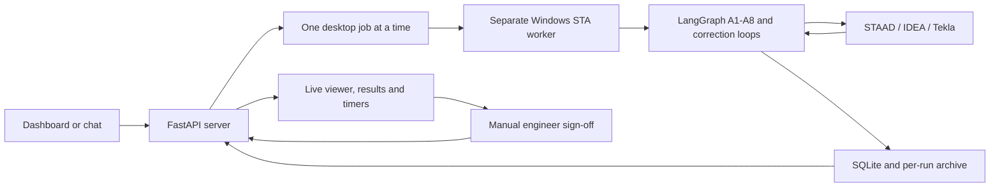
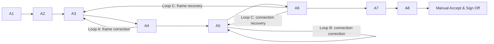

# Civil Steel Standard - Agentic Workflow

A Windows application for radiator-support steel-frame design using **STAAD.Pro**, **IDEA StatiCa Connection**, and **Tekla Structures**. A browser dashboard and engineering chat feed a controlled A1-A8 pipeline that generates geometry, runs calculations, validates evidence, publishes a model and prepares a package for **manual engineer sign-off**.

LangGraph controls execution. Optional Deep Agents add LLM planning and review around the same engineering tools; they do not replace native calculations or graders.

> Live operations modify the open engineering models. Use designated working models. The application is intended for a controlled local/RDP desktop; authentication is not implemented.

## Contents

- [Architecture](#architecture)
- [Installation](#installation)
- [Start and stop services](#start-and-stop-services)
- [Configuration](#configuration)
- [A1-A8 workflow](#a1-a8-workflow)
- [Dashboard and chat](#dashboard-and-chat)
- [Rules for one run](#rules-for-one-run)
- [API reference](#api-reference)
- [Outputs and storage](#outputs-and-storage)
- [Repository structure](#repository-structure)
- [Testing](#testing)
- [Troubleshooting](#troubleshooting)

## Architecture



| Component | Responsibility |
|---|---|
| Static frontend | HTML, JavaScript and Three.js dashboard; no React build or separate Node server. |
| FastAPI | Request validation, chat tools, run dispatch, progress and approval endpoints. |
| Worker | Disposable process owning the STA/COM thread required by native adapters. |
| LangGraph | Sequential agents, correction routing and final approval pause. |
| Optional LLM | Conversational tool selection, bounded Deep Agents review and supported correction advice. |
| Storage | Saved run/chat state, logs, agent timings and per-run evidence archives. |

## Installation

### Prerequisites

| Requirement | Notes |
|---|---|
| Windows engineering desktop/RDP | Run the API and native applications in the same interactive user/session. |
| 64-bit Python **3.11+** | Required by pinned Deep Agents/LangChain packages. Check native SDK compatibility; the development installation uses Python 3.14. |
| STAAD.Pro | Installed, licensed, with a **saved analytical `.std` model** open. |
| Tekla Structures | Installed, licensed, with a saved working model and matching Open API DLLs. |
| IDEA StatiCa Connection REST | Running service and compatible Python client product release. |
| Authorized model credentials | Needed for chat, Deep Agents or correction advice. Deterministic dashboard execution does not require LLM calls. |
| Node.js / Playwright | Optional development tools for frontend/browser tests. |

### Create the Python environment

Use PowerShell. The repository is private; use your authorized Git credentials.

```powershell
git clone --branch chat_interface_agenticworkflow https://github.com/SiddharthSo1210/civil-steel-standard-agentic.git agentic-flow
Set-Location .\agentic-flow
python -m venv .venv
.\.venv\Scripts\Activate.ps1
python -m pip install --upgrade pip
python -m pip install -r requirements.txt
```

If activation is blocked, use `.\.venv\Scripts\python.exe` directly instead of `python`; activation is optional. Keep an existing host's `.env`, models and virtual environment rather than replacing them with another machine's copies.

### Install OpenSTAADPy separately

`openstaadpy` ships with STAAD.Pro and is not installed by `requirements.txt`. Adjust this example to the installed version:

```powershell
python -m pip install "C:\Program Files\Bentley\Engineering\STAAD.Pro 2025\STAAD\OpenSTAADPy\Setup\openstaadpy-25.0.1.1.tar.gz"
```

Current pins include `deepagents==0.7.39`, `langchain-openai==1.8.0`, and `ideastatica-connection-api==26.0.5.1427`. A2 checks the IDEA service/client **major and minor release**, not an exact build match. Tekla DLLs are loaded through `pythonnet` from `TEKLA_BIN_PATH`.

### Configure the host

Copy the template only when `.env` does not already exist:

```powershell
if (-not (Test-Path .env)) { Copy-Item .env.example .env }
```

Edit `.env` with host paths, execution switches and private credentials. It is ignored by Git. Prepare the native applications below, then start the API.

## Start and stop services

These executable paths are **examples** for STAAD 2025, Tekla 2025 and IDEA 26.0. Use installed shortcuts if they supply environment/licensing arguments. Avoid duplicate services.

### Native applications - open once

```powershell
# Open a saved analytical .std model; no analysis should already be running.
Start-Process -FilePath "C:\Program Files\Bentley\Engineering\STAAD.Pro 2025\STAAD\Bentley.Staad.exe"

# Select the appropriate Tekla environment and open a saved working model.
Start-Process -FilePath "C:\TeklaStructures\2025.0\bin\TeklaStructures.exe"
```

### Terminal 1 - IDEA REST service

```powershell
& "C:\Program Files\IDEA StatiCa\StatiCa 26.0\IdeaStatiCa.ConnectionRestApi.exe"
```

Keep this terminal open for diagnostics. `IDEA_STATICA_BASE_URL` normally points to `http://localhost:5000`; changing it changes the client destination, not the native service listener. Read-only check from another terminal:

```powershell
Invoke-RestMethod "http://localhost:5000/api/4/clients/idea-service-version"
```

### Terminal 2 - API and dashboard

From the repository root:

```powershell
.\.venv\Scripts\python.exe -u src\server.py --port 8060
```

| URL | Purpose |
|---|---|
| <http://localhost:8060/radiator_support> | Dashboard and engineering chat |
| <http://localhost:8060/docs> | Interactive request/response schemas |
| <http://localhost:8060/openapi.json> | Generated API contract |

The API launches its own workers. No separate frontend server, LangGraph daemon or queue service is required. `--port` overrides `PLANT_PORT`; the template uses `8060`, while the code fallback is `8080`. `start_server.bat` works too, but its printed URL is hardcoded to 8080.

### Stop and restart

Let an active run finish, or use **Stop current run** before maintenance. Press **Ctrl+C** in the API terminal, then rerun the start command. Use **Ctrl+F5** after UI updates. Python and `.env` updates require an API restart; healthy native applications need not restart.

If the server terminal is unavailable, stop the listener on 8060:

```powershell
Get-NetTCPConnection -LocalPort 8060 -State Listen -ErrorAction SilentlyContinue |
    Select-Object -ExpandProperty OwningProcess -Unique |
    ForEach-Object { Stop-Process -Id $_ -Force }
```

Forced server termination is not the normal way to cancel native calculations.

## Configuration

`.env` loads from the repository root. Existing process environment variables normally take precedence. Explicit `.env` tracing flags are an exception: startup aligns `LANGSMITH_TRACING` and `LANGSMITH_TRACING_V2` with the file. New workers inherit server settings.

### Execution switches

| Setting | `false` | `true` |
|---|---|---|
| `PLANT_CHAT_ENABLED` | Chat disabled; dashboard/API available. | Conversational tools enabled when credentials are configured. |
| `PLANT_LLM_ENABLED` | Correction advice and Deep Agents model access disabled. | Allows correction advice and Deep Agents model access. |
| `PLANT_DEEP_AGENTS_ENABLED` | Direct engineering functions inside LangGraph. | Bounded Deep Agents wrapper for each stage; also requires LLM enabled and credentials. |
| `PLANT_LIVE_ENGINEERING_ENABLED` | Blocks live readiness/dispatch; saved results and explicit unverified preview remain available. | Allows native operations subject to checks. |
| `LANGSMITH_TRACING` | Tracing disabled when explicitly set in `.env`. | SDK tracing to the configured LangSmith project/key. |

**Deterministic A1-A8, with optional LLM-powered chat:**

```env
PLANT_WORKFLOW_MODE=poc2_automation
PLANT_DEEP_AGENTS_ENABLED=false
PLANT_LLM_ENABLED=false
PLANT_CHAT_ENABLED=true
```

Set `PLANT_CHAT_ENABLED=false` too if no conversational model calls are wanted. Chat's model is independent of the stage/advisor switches.

**Deep Agents:**

```env
PLANT_WORKFLOW_MODE=poc2_automation
PLANT_DEEP_AGENTS_ENABLED=true
PLANT_LLM_ENABLED=true
PLANT_CHAT_ENABLED=true
PLANT_AGENT_MODEL=<model-or-deployment-supported-by-your-endpoint>
OPENAI_BASE_URL=<your-OpenAI-compatible-base-URL>
OPENAI_API_KEY=<your-private-key>
```

Chat cannot switch the worker engine just by mentioning Deep Agents. The environment selects it. Enabling Deep Agents while disabling LLM access fails stage execution; it does not silently fall back.

### Settings reference

The table distinguishes template values from code fallbacks where they differ.

| Setting | Meaning / starting value |
|---|---|
| `PLANT_HOST`, `PLANT_PORT` | `127.0.0.1`; template port `8060`, fallback `8080`. |
| `PLANT_AGENT_MODEL`, `OPENAI_BASE_URL`, `OPENAI_API_KEY` | Authorized tool-calling model, endpoint and secret. Template model names must be valid for your deployment. |
| `TEKLA_BIN_PATH` | Tekla DLL folder; template `C:/TeklaStructures/2025.0/bin`. |
| `IDEA_STATICA_BASE_URL` | REST endpoint; `http://localhost:5000`. |
| `PLANT_TEMPLATE_DIRECTORY` | Optional template folder; fallback `sample_projects/`. |
| `PLANT_LOAD_COMBINATIONS_FILE` | Optional JSON with `combinations`; used when request combinations are absent. |
| `STAAD_SECTION_DATABASE_PATH` | Optional explicit section-database location; otherwise discovered from installed software. |
| `PLANT_MAX_FRAME_REVISIONS`, `PLANT_MAX_CONNECTION_REVISIONS` | Template `2` each; fallback `3` each. Loop C defaults to `2` in state, not `.env`. |
| `PLANT_AGENT_TIMEOUT_SECONDS`, `PLANT_RUN_TIMEOUT_SECONDS` | Progress budget `180`; total worker budget `3600` seconds. |
| `PLANT_IDEA_CALCULATION_TIMEOUT_SECONDS` | Minimum IDEA allowance; fallback `600`. Actual budget: `min(run_timeout, max(minimum, agent_timeout * effect_count))`. |
| `PLANT_MODEL_CALL_LIMIT` | Correction-advisor budget; `6`. |
| `PLANT_DEEP_AGENT_MODEL_CALL_LIMIT` | `64` model requests per run; each stage visit also has a four-request cap. |
| `PLANT_CHAT_MODEL_CALL_LIMIT`, `PLANT_CHAT_TOOL_CALL_LIMIT` | `10` model / `12` tool calls per turn. |
| `PLANT_CHAT_TOKEN_LIMIT`, `PLANT_CHAT_CONTEXT_CHAR_LIMIT` | `64000` reported tokens / `60000` context characters. |
| `PLANT_CHAT_REQUESTS_PER_MINUTE`, `PLANT_CHAT_GLOBAL_REQUESTS_PER_MINUTE` | `30` per session / `120` globally. |
| `PLANT_CHAT_CONCURRENT_REQUESTS` | `4` chat turns; native desktop workflows remain serialized. |
| `PLANT_CHAT_INPUT_COST_PER_MILLION`, `PLANT_CHAT_OUTPUT_COST_PER_MILLION` | Optional usage prices; blank means no cost estimate. Backend usage remains stored; its chat panel is hidden. |
| `PLANT_CHAT_DATABASE_PATH`, `PLANT_RUNS_DATABASE_PATH` | Optional alternate stores; blank uses `data/chat.db`, `data/runs.db`. |
| `LANGSMITH_API_KEY`, `LANGSMITH_PROJECT` | Tracing key and project; template project `plant-engineering`. |

Reserved settings do not implement additional behaviour: `PLANT_ENVIRONMENT`, `PLANT_INITIALIZE_DATABASE`, `PLANT_WORKER_ID`, `PLANT_AUTH_ENABLED`, `PLANT_ENGINEER_TOKEN`, `PLANT_APPROVER_TOKEN`, `PLANT_ANALYSIS_APPROVAL_MODE`, `PLANT_PUBLICATION_APPROVAL_MODE`. They do not add authentication or bypass final approval.

LangSmith traces can include prompts, responses and tool data. Use an authorized destination; never paste credentials into chat. Check actual trace delivery in the configured dashboard after a request.

### Workflow modes

| `PLANT_WORKFLOW_MODE` | Implemented behaviour |
|---|---|
| `poc1_automation` | Reference procedure and standard connection details, still within the A1-A8 graph. |
| `poc2_automation` | Default reference basis with existing graders and supported correction/validation loops. |
| `reviewed_engineering` | Explicit load combinations and IDEA template coverage for every required joint family. Standard details do not substitute for individual IDEA verification. |

Both reference modes share the existing graph and checks; mode names do not select the LLM engine or disable correction loops.

Reference modes use **8 combinations and 3 envelopes** when custom combinations are absent. Request combinations take precedence over the optional file. Reference defaults reproduce the existing procedure; they do not independently establish project-code compliance.

## A1-A8 workflow

| Agent | Responsibility | Output / decision |
|---|---|---|
| **A1 - Requirements Validator** | Validate grid and run policy; resolve loads/combinations. | Normalized brief, active profiles and thresholds. |
| **A2 - Readiness Checker** | Check saved STAAD/Tekla models, IDEA service/SDK and templates. | Readiness evidence or early failure. |
| **A3 - Frame Generator** | Generate physical and split analytical geometry; check native profile dimensions and templates. | Frame candidate and joint-family scope. |
| **A4 - STAAD Analyzer** | Run structural analysis and grade ratios/displacements. | Results, frame grade or Loop A correction. |
| **A5 - IDEA Analyzer** | Calculate required connection families and grade supported corrections. | Connection evidence, joint grades or Loop B correction. |
| **A6 - Package Validator** | Independently recheck grades, signatures, materials and coverage. | Verified package/hash or Loop C recovery. |
| **A7 - Tekla Modeler** | Publish members/connections, read back attributes and save. | Publication results and member/component manifests. |
| **A8 - Reporting and Acceptance** | Assemble the package and pause for review. | `PAUSED_AT_GATE3`; manual acceptance sets `COMPLETED`. |



- Execution is sequential. A controller/lock permits one agentic desktop job at a time.
- Corrections need verified mappings and exposed parameters. Unsupported localization stops the run instead of guessing changes to several details.
- Failed native checks are never replaced with simulated passes. Unchanged signature-matched IDEA evidence may be reused and is rechecked.
- Full A7 publication cleans/rebuilds the working model. Selected connection edits use a separate guarded adapter and cannot silently call that rebuild.

### LangGraph versus Deep Agents

With Deep Agents disabled, LangGraph directly executes the Python stages. With it enabled, each stage visit runs a bounded **plan -> execute-stage tool once -> review** cycle using `create_deep_agent`. The engineering function, graders and correction routing stay authoritative.

The stage model has its stage tool and `write_todos`; it cannot invoke another stage, edit arbitrary files, bypass checks or approve A8. A model failure, skipped execution or duplicate tool request fails the run without a silent deterministic fallback. The separate correction advisor selects supported candidates and has its own deterministic fallback behaviour.

### What is actually verified

A joint-group dropdown entry means STAAD identified that family, not that IDEA calculated it separately. Reference modes calculate groups mapped in `reference_procedure.py` and use declared Tekla details for the rest. A common double-longitudinal frame calculates:

- `inner_node_2_longitudinal_bracings`
- `inner_node_2_longitudinal_1_transverse_bracing`

Other geometries may use the mapped single-longitudinal families. Standard components include **1004, 144, 20 and 30**. The final package distinguishes calculated families from standard details; the latter must not be called individually IDEA-verified.

Checks cover grid dimensions, load combinations, finite results, native profiles/templates, calculation coverage, evidence signatures, material identity, configured limits and publication readback. These checks do not imply every possible engineering requirement is implemented.

## Dashboard and chat

### Dashboard

1. Prepare the three native applications and their working models.
2. Review grid, profiles, materials, bracing and loads. Initial form defaults do not automatically read every value from `frame_specs.json` on page load.
3. Select **Run Agentic Design (A1-A8)**. Geometry, results and status update from saved progress.
4. Review failures or the A8 package. An engineer uses **Accept & Sign Off** for final acceptance.

Manual **Generate Structure**, **Send to STAAD**, **Send to IDEA StatiCa** and **Update Tekla** are separate operations. They do not alone create a complete A1-A8 archive. **New Run / Reset View** clears the presentation while retaining inputs and saved runs; it is not a master-input reset.

### Engineering chat

Chat includes current form inputs automatically. For exact file inputs, attach JSON through **+**. To use the master, attach `src/radiator_support/frame_specs.json`, then send:

```text
Run the complete A1-A8 workflow using the attached JSON exactly.
Use default engineering rules. Show the input preview for approval first.
Continue through Tekla and A8, then wait for my manual sign-off.
Stop and explain any required check failure.
```

Example customization:

```text
Run A1-A8 for an 8x5 frame. Longitudinal brace bays: 4 and 6,
mirror unchecked. Transverse brace bays: 2 and 4, mirror unchecked.
Use maximum bolt utilization 90% for this run only; keep other inputs
and rules unchanged. Show the approval preview first, then run through
Tekla and A8. Wait for my manual final sign-off.
```

```text
Message + inputs -> scope check -> tool selection -> validated policy/inputs
-> change preview -> manual Approve & Apply -> existing worker pipeline
-> live results -> A8 manual sign-off -> same conversation remains available
```

| Capability | Behaviour |
|---|---|
| Scope guardrails | Block unrelated requests; clarify mixed/ambiguous requests. Questions receive read-only capabilities. |
| Change approval | Execute the exact stored preview once or reject it. The LLM cannot approve its own proposal. Changed inputs/templates invalidate it. |
| Selected joint edits | Exact existing names/keys and verified units. "Group 1" or "parameter 1" is not inferred from dropdown positions. |
| Selected Tekla changes | Require verified manifests and supported attribute mappings. Legacy, shared or derived-layout changes can be blocked. |
| Attachments | Bounded text/preview readers; no macros or arbitrary instructions. Original binary documents are not retained as executable files. |
| Live progress | Chat and buttons use saved workflow progress. Old solver evidence is not rebound to modified inputs. |
| General versus narrow requests | "Run workflow" includes A7/A8; "STAAD only" retains narrower scope. |
| Saved conversations | History, rename/share/copy, refresh restoration and continued chat after sign-off. |

After a **chat-dispatched** run completes, fails or is cancelled, next-run geometry and loads reload the read-only master `frame_specs.json`. Active calculations, stage continuations and pending A8 approval keep their current inputs. Saved results retain the actual custom inputs; chat never rewrites the master. A historical browser view can still show the inspected run rather than a fresh master view.

### Live timers

Each A1-A8 box displays **`MM:SS`** beneath its label. Timers use saved backend timestamps, update live and survive refresh. Repeated stage visits add execution time, including LLM/Deep Agents overhead. Time between stages and manual A8 approval waiting are excluded. New stages show `00:00`; older stages without recorded timing show `--:--`. These are elapsed times, not completion estimates.

## Rules for one run

Supply supported thresholds through chat or top-level `run_policy` JSON. When rules and geometry change together, chat must set the policy **before** creating the input preview. A backend check prevents explicit numeric rules from being omitted or silently replaced with defaults.

| Field | Default | Accepted range |
|---|---:|---|
| `max_member_ratio` | `1.0` | `0 < value <= 1.0` |
| `drift_denominator` | `200` | `value >= 200`; H/300 uses `300` |
| `max_bolt_utilization_percent` | `75` | `0 < value <= 100`; one-run `90` is supported |
| `max_weld_utilization_percent` | `100` | `0 < value <= 100` |
| `max_plate_utilization_percent` | `100` | `0 < value <= 100` |
| `max_deformation_utilization_percent` | `100` | `0 < value <= 100` |

A4, A5, correction decisions and A6 use the validated policy; A8 and the archive record it. An 85% bolt result can satisfy a 90% rubric, but still fails when IDEA reports a native failure. Disabling checks, nonfinite values, arbitrary formulas and unknown fields are unsupported. Manual acceptance remains mandatory.

Chat consumes queued rules when a new live run is dispatched, including a failed run. Busy/disabled dispatch and geometry-only preview do not consume them. Later new runs use defaults unless another override is supplied. Direct API resubmission of custom JSON explicitly requests that policy again; continuations retain their source policy.

## API reference

Request schemas: `/docs`. Generated contract: `/openapi.json`. Agents are internal graph nodes; individual `/A1` through `/A8` HTTP endpoints are not implemented.

### Workflow - prefix `/api/v2/agentic`

| Method | Path | Purpose / side effect |
|---|---|---|
| POST | `/run` | Start A1-A8 with `{grid, load_configuration?, run_policy?}`. Uses native tools; response waits for worker outcome. |
| GET | `/active` | Read current state or `null`. |
| GET | `/runs?limit=50` | List saved runs. |
| GET | `/runs/{run_id}` | Read complete workflow JSON, progress, results, timings and logs. |
| POST | `/cancel/{run_id}` | Cancel the owned worker. |
| POST | `/retry-publication/{source_run_id}` | Fork an eligible failed publication, re-audit evidence and retry A7/A8. |
| POST | `/accept/{run_id}` | Manual Gate 3 acceptance; optional `{"engineer_name":"Your name"}`. Rejects failed/unverified packages. |

Read-only examples:

```powershell
Invoke-RestMethod "http://localhost:8060/api/v2/agentic/active"
Invoke-RestMethod "http://localhost:8060/api/v2/agentic/runs?limit=10"
```

This next command **starts native operations** and can take several minutes:

```powershell
$inputJson = Get-Content -LiteralPath .\src\radiator_support\frame_specs.json -Raw
Invoke-RestMethod -Method Post -Uri "http://localhost:8060/api/v2/agentic/run" `
    -ContentType "application/json" -Body $inputJson
```

The direct API runs supplied JSON; it does not merge in the master automatically. Master reset is a chat-session feature.

### Chat - prefix `/api/v2/chat`

| Method | Path | Purpose |
|---|---|---|
| GET | `/config` | Chat readiness/model; no credentials. |
| GET / POST | `/sessions` | List / create conversations. |
| GET / PATCH | `/sessions/{session_id}` | Read history, drafts, pending changes / rename with `{"title":"..."}`. |
| POST | `/messages` | Submit `message`, optional session/input/run/attachment fields and `allow_native_tools`; returns `202` with `turn_id`. |
| GET | `/turns/{turn_id}` | Poll tool events, inputs and engineering progress. |
| POST | `/turns/{turn_id}/cancel` | Cancel active chat task; inspect associated run before retrying. |
| POST | `/sessions/{session_id}/attachments?filename=...` | Upload raw file bytes. |
| DELETE | `/sessions/{session_id}/attachments/{attachment_id}` | Remove unsent attachment; sent history retained. |
| GET | `/sessions/{session_id}/changes/{proposal_id}` | Read approval preview. |
| POST | `/sessions/{session_id}/changes/{proposal_id}/reject` | Reject without applying. |
| POST | `/sessions/{session_id}/changes/{proposal_id}/approve` | Approve exact `digest`; native action also needs `allow_native_tools:true`. Returns an execution turn. |

Internal tools cover context/status reads, input/policy proposals, joint parameters, preview, generation, analysis, connections, validation, publication and full workflow. Tool names are not separate HTTP endpoints. Details: [CHAT_INTERFACE.md](CHAT_INTERFACE.md).

### Manual integration endpoints

| Method | Full path | Purpose |
|---|---|---|
| POST | `/api/v1/radiator_support/generate` | Generate geometry from `grid`; native profile dimensions may be required. |
| POST | `/api/v1/radiator_support/to_staad` | Send grid, split analytical members and loads to STAAD. |
| POST | `/api/v1/to_ideastatica` | Run a native connection-design request. |
| POST | `/api/v1/radiator_support/to_tekla` | Send physical members, grid and joint groups to Tekla. |

The server blocks conflicting integration calls while its agentic worker owns the desktop tools. Manual integration requests do not replace full package validation or engineer acceptance.

## Outputs and storage

New workflow runs create a directory under **`store output run/`**, named with the run ID and start date/time in IST. Files update at saved checkpoints and stage boundaries; retries and individual IDEA calculations keep separate evidence.

```text
store output run/
+-- run_<id>_23_November_2026_17-20-44_IST/
    +-- 00_input/
    |   +-- original_input.json
    |   +-- effective_input.json
    |   +-- run_policy.json
    +-- 01_agents/
    |   +-- A1/attempt_001/{input.json, output.json, process.json}
    |   +-- A2/ ... A8/
    |   +-- A5/attempt_002/             # when retried
    +-- 02_software/
    |   +-- STAAD/attempt_001/
    |   +-- IDEA_StatiCa/<exact_group>/calculation_001/
    |   +-- Tekla/attempt_001/          # model_snapshot/ when copied
    +-- 03_final_output/
    |   +-- workflow_output.json
    |   +-- final_report.json
    |   +-- validation_results.json
    |   +-- agent_timings.json
    |   +-- engineer_approval.json
    +-- 04_logs/{events.json, worker.log}
    +-- manifest.json
```

| Location | Contents |
|---|---|
| `data/runs.db` | Authoritative saved state: input, policy, results, timing, logs and approval. Latest state updates; archive folders preserve stage attempts. |
| `data/chat.db` | Conversations, tool events, change plans and usage. |
| `data/worker_logs/<run_id>.log` | Worker diagnostics. |
| `store output run/<run_id>/` | Run evidence and native copies. Saved JSON identifies it in `output_archive.directory`. |
| `output_exports/dynamic_changes/` | Additional exports for approved chat changes. |
| `output_<joint_group>/` | Existing native working-output folders. Available artifacts are copied to the archive before a later solve overwrites them. |

- `original_input.json` is the JSON dispatched to the workflow. `effective_input.json` contains normalized inputs and rules. Agent input/output files are boundary snapshots of shared state; `process.json` records events, loops, errors and timing, not private LLM reasoning.
- STAAD copies include available `.std`/companion files. IDEA copies include `.ideaCon`, summary, connection data, raw results and PDFs **when generated**. Archiving does not enable additional native calculations/reports.
- Tekla copies saved model files/attributes, excludes locks/temp files and checks for changes during copying. These are **open-model copies, not independently reopen-verified backups**. Read `snapshot_status` and the software copy manifests.
- Copy manifests list hashes, missing/locked files and exclusions. Unexecuted agents have no invented outputs; inherited evidence is distinguishable from newly recorded execution.
- Final approval updates the archive. Report preparation alone is not acceptance: inspect `engineer_approval.json` and run status.
- Archive I/O uses time and disk space. Failures are logged/recorded where possible without bypassing engineering checks. Successful calculations do not guarantee every file copied successfully.
- Archives, databases, logs and `.env` are excluded from Git. Historical jobs are not replayed to manufacture missing records.

Detailed contract: [docs/run_outputs.md](docs/run_outputs.md).

## Repository structure

```text
agentic-flow/
+-- README.md
+-- .env.example                  # template; real .env stays local
+-- requirements.txt
+-- start_server.bat
+-- src/
|   +-- server.py                 # FastAPI and manual integration routes
|   +-- agentic/
|   |   +-- agents/a1_* ... a8_*.py # engineering stages
|   |   +-- orchestrator.py       # graph sequencing and correction routing
|   |   +-- state.py              # WorkflowState and grader records
|   |   +-- execution.py          # worker, timeouts and cancellation
|   |   +-- worker.py             # disposable STA worker entry point
|   |   +-- deep_runtime.py       # bounded per-stage Deep Agents
|   |   +-- advisor.py            # correction-candidate advice
|   |   +-- router.py / store.py  # workflow API and persistence
|   |   +-- chat*.py              # chat runtime, scope, lifetime and edits
|   |   +-- run_policy.py         # run-specific thresholds
|   |   +-- agent_timing.py       # execution clocks
|   |   +-- run_archive.py        # per-run JSON and native copies
|   |   +-- evidence.py           # candidate signatures
|   |   +-- reference_procedure.py / load_combinations.py
|   |   +-- tekla_selected_updates.py / publication_recovery.py
|   +-- common/                   # shared native adapters
|   +-- radiator_support/
|   |   +-- frame_specs.json      # master input; preserve project edits
|   |   +-- generate_grid.py
|   |   +-- *_integration.py
|   +-- static/radiator_support/  # dashboard, results, chat and timers
+-- sample_projects/              # samples and IDEA templates
+-- tekla_connection_attributes/  # native component attributes
+-- typings/                      # native API editor assistance
+-- scripts/                      # regression, browser and live probes
+-- tests/                        # controlled backend/frontend tests
+-- docs/                         # implementation documentation
+-- data/                         # generated local state
+-- output_exports/               # generated change/verification exports
+-- store output run/             # generated per-run archives
```

Further reading: [CHAT_INTERFACE.md](CHAT_INTERFACE.md), [run policy](docs/run_policy.md), [run outputs](docs/run_outputs.md). Source and generated OpenAPI remain authoritative if older technical reports differ from current implementation.

## Testing

Use isolated databases: chat-store imports perform startup recovery and must not touch live conversations. Run from the repository root in a **separate test terminal**:

```powershell
New-Item -ItemType Directory -Force .\output_exports\tests | Out-Null
$env:PLANT_CHAT_DATABASE_PATH = Join-Path $PWD 'output_exports\tests\chat.db'
$env:PLANT_RUNS_DATABASE_PATH = Join-Path $PWD 'output_exports\tests\runs.db'
$env:LANGSMITH_TRACING = 'false'
$env:LANGSMITH_TRACING_V2 = 'false'
.\.venv\Scripts\python.exe -m unittest discover -s tests
```

Do not launch production from that test terminal: inherited database variables take precedence over `.env`. Use a fresh server terminal.

Frontend tests need Node.js, not a frontend server:

```powershell
node tests\test_agent_timers.cjs
node tests\test_agentic_restore.cjs
node tests\test_staad_results.cjs
```

Optional approval-preview browser check, using an installed Edge browser and fixture APIs:

```powershell
.\.venv\Scripts\python.exe -m pip install playwright
.\.venv\Scripts\python.exe scripts\smoke_chat_changes.py
```

Inspect other scripts before executing them: some perform live operations. `validate_dynamic_chat.py --live-model` sends test prompts to the configured LLM and may incur charges.

Latest archive verification: **297 backend tests and 31 frontend checks passed**. These are controlled tests with native operations mocked or synthetic files. They do not guarantee future native calculations or independent Tekla model reopening.

## Troubleshooting

| Symptom | Check / action |
|---|---|
| Port already occupied | Inspect `Get-NetTCPConnection`; stop the old project server before starting another. |
| Changes not visible | Restart the idle API for Python/`.env` updates; Ctrl+F5 for static assets. Existing jobs retain their original inputs/engine. |
| Chat unavailable | Check the chat switch, endpoint/model/key and `/api/v2/chat/config`. Credentials never belong in messages. |
| Deep Agents fails immediately | Check both execution switches and credentials. Inspect `deep_agent_events`; no silent engine fallback is provided. |
| Profile unavailable | Check exact names in the active Tekla environment. Live lookup checks library and parametric profiles; guessed dimensions are not verification evidence. |
| A5 progress unchanged | Legacy synchronous IDEA solves may provide no intermediate progress while processing several load effects. `RUNNING` alone does not prove active solver work. Inspect logs and the native service. |
| IDEA timeout or cancellation | Async jobs request cancellation. A legacy HTTP timeout/worker stop does not prove native computation stopped; readiness checks for lingering IDEA-owned solvers. |
| Tekla looks blank | Verify model path, work area, filters and view. Redraw does not move a misplaced work area; try **Fit work area to entire model**. |
| Timer shows `--:--` | Historical run lacks timing data. New workers record timing; refresh cannot create missing past records. |
| Customized fields remain visible | Distinguish the inspected historical run from next-run inputs. Pending approval keeps current inputs; attach the master in a fresh request to explicitly select its exact values. |
| Native archive incomplete | Read `copy_manifest.json` and `output_archive.warnings`; locked/missing files do not become successful exports. |
| Approval rejected | Inputs, source evidence, policy or templates may be stale. Create a fresh preview. A8 acceptance requires passing validation and A7. |

Shared STAAD/Tekla cleanup utilities in `src/common` are destructive and save changes; they are not a normal startup step. Inspect their implementation and use designated working models before invoking them.
