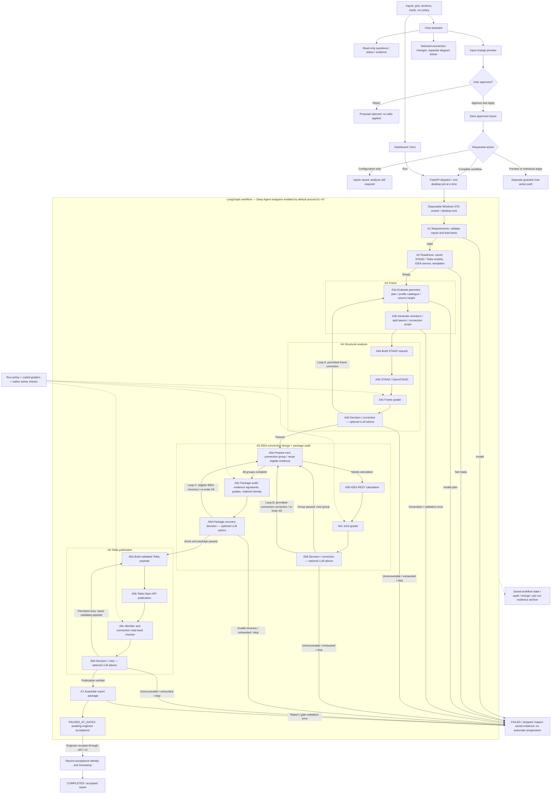
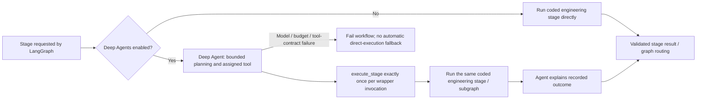
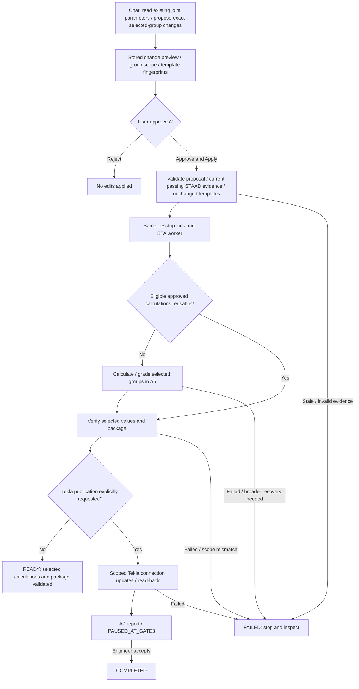

# Civil Steel: implemented engineering workflow

Checked against the current A1–A7 (`layout_version=2`) workflow. This is a control-flow map, not a claim that live engineering calculations have been verified. Solid arrows show execution; dotted arrows show shared configuration or recording. Each stage can stop on an error. Retry arrows require eligible recovery, remaining budget, and a continue decision.

Open [the offline visual diagram](workflow_diagram.html) in a browser, or preview the Mermaid diagrams below in a compatible Markdown viewer.

## Complete workflow and chat entry

For an approved input change requesting a complete run, A1 executes before the graph enters A2. A1 is not skipped. The complete workflow normally starts the graph at A1. Chat's preview and individual-stage actions have their own prerequisites and may finish at `READY`; an unverified geometry preview is not engineering approval.

Hard tool errors can stop a subgraph before its decision node. The failure arrows summarize these exits; they do not imply every error reaches the LLM or is retried. In A5, a passing group advances to the next group; a failed group requiring correction exits and re-enters A5 through the outer routing. Eligible existing results can be skipped/reused. Package recovery is Loop C, distinct from Loop B.

## AI execution layer (enabled by default)

`PLANT_DEEP_AGENTS_ENABLED` and `PLANT_LLM_ENABLED` default to `true` in the runtime and `.env.example`. The wrappers require a configured model and credentials. Set the Deep Agents flag to `false` for direct stage execution, and set the LLM flag to `false` as well to disable correction advice. Each wrapper is around an outer stage, not a separate Deep Agent at every a/b/c/d substep. It cannot bypass graders, call another stage, edit engineering criteria, or approve Gate 3; general-purpose subagent delegation is disabled. The correction advisor selects only prevalidated choices and falls back to the deterministic choice if unavailable or unsuccessful. Its fallback behavior differs from a Deep Agent wrapper failure. Chat has its own enable switch.

## Selected-connection changes

Selected updates preserve the approved group scope. A full-model Tekla rebuild is not substituted. Existing calculations are reused only where the scoped proposal permits it. This diagram covers selected connection edits; chat also exposes guarded preview, generate, frame analysis, connection design, package validation and publication actions.

## Source map

| Behavior | Implementation |
|---|---|
| Main graph, Deep Agent switch, A1 before A2 on changed-input reruns | `src/orchestration/workflow.py` |
| Frame / connection / package routing | `src/orchestration/routing.py` |
| Stage substeps | `src/agents/A3_generate_structure/graph.py`, `src/agents/A4_staad/graph.py`, `src/agents/A5_idea_statica/graph.py`, `src/agents/A6_tekla/graph.py` |
| Deep Agent tool limits and fail-closed execution | `src/services/deep_agents_runtime.py` |
| Optional correction choices and fallback | `src/services/correction_advisor.py` |
| Chat previews, approval execution, configuration-only outcome | `src/chatbot/chatbot.py` |
| Selected and individual-stage execution | `src/chatbot/chat_actions.py`, `src/agents/A6_tekla/selected_updates.py` |
| Run thresholds and graders | `src/config/run_policy.py`, `src/agents/A4_staad/A4C_evaluate_results.py`, `src/agents/A5_idea_statica/A5C_evaluate_and_audit.py`, `src/agents/A5_idea_statica/package_validation.py`, `src/agents/A6_tekla/A6C_check_publication.py` |
| Tekla retry qualification | `src/agents/A6_tekla/publication_corrections.py` |
| Report and acceptance | `src/agents/A7_reporting/build_report.py`, `src/agents/A7_reporting/human_gate.py`, `src/orchestration/dashboard_router.py` |
| Process ownership / mutual exclusion | `src/orchestration/execution.py`, `src/orchestration/worker.py`, `src/orchestration/desktop_lock.py` |
| State / audit / archives | `src/services/workflow_store.py`, `src/utils/audit.py`, `src/utils/run_archive.py` |

Only `layout_version=2` is supported. `node_package_audit` runs A5c, `node_a6` runs Tekla, and `node_a7` runs reporting. This map covers orchestration and its important branches, not every endpoint or exception handler. Historical records from other layouts are preserved on disk but excluded from the current application's run listing and loading; start a new run to use the current workflow.
